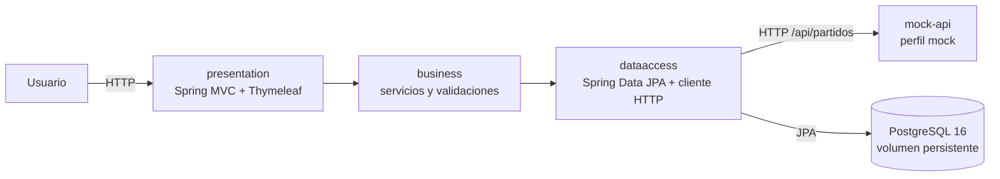

# Champions — Partidos y Predicciones

Solución de la pregunta 1 del Laboratorio 5, implementada en **Java 21** con
Spring Boot, Spring MVC, Thymeleaf, Spring Data JPA y PostgreSQL 16.
Los partidos del servicio simulado son ejemplos académicos; **no representan
el calendario oficial de la UEFA**.

## Arquitectura y flujo

El proyecto separa presentación (`presentation`), lógica (`business`) y acceso
a datos (`dataaccess`). Los controladores invocan servicios; los servicios
coordinan los repositorios JPA y el cliente HTTP. Al arrancar, el perfil `app`
espera la API y PostgreSQL, consulta por HTTP el catálogo simulado, valida e
importa todos los partidos en una transacción. El ID externo único hace que
las importaciones repetidas actualicen partidos sin duplicarlos. Las
predicciones tienen una clave foránea al partido y se conservan al reiniciar.



El diagrama ampliado y el flujo de arranque están en
[docs/arquitectura.md](docs/arquitectura.md).

## Funcionalidad

- `/`: catálogo completo importado y leído desde PostgreSQL.
- `/partidos/{id}/prediccion`: registrar ganador y goles estimados.
- `/predicciones`: historial de predicciones asociado a cada partido.
- `/health`: comprueba la conexión a la base de datos.
- El servidor rechaza valores vacíos, goles no enteros o negativos, partidos
  inexistentes y resultados incompatibles con el marcador.
- La aplicación usa Post/Redirect/Get después de guardar.

## Preparación y ejecución local

Necesitas Docker Desktop con Docker Compose v2 (o Docker Engine y el
complemento Compose v2 en Linux). Para ejecutar las pruebas también necesitas
Java 21; no hace falta instalar Maven porque el proyecto incluye Maven Wrapper.
Ejecuta los comandos desde la carpeta raíz del proyecto.

### 1. Configurar las variables

Crea tu archivo `.env` a partir de la plantilla:

**Windows PowerShell**

```powershell
if (-not (Test-Path .env)) { Copy-Item .env.example .env }
notepad .env
```

**Linux / Ubuntu**

```bash
[ -f .env ] || cp .env.example .env
nano .env
```

En `.env`, cambia `POSTGRES_PASSWORD=CAMBIAR` por una contraseña propia. No
compartas ni publiques el archivo `.env`. `APP_PORT` es el puerto de tu PC
que se conecta al puerto 8080 del contenedor: si el puerto 8000 ya está
ocupado, cambia, por ejemplo, `APP_PORT=8001` y luego usa ese puerto en la URL.
Las demás variables de la plantilla sirven para la configuración predeterminada
y normalmente no necesitan cambios.

### 2. Ejecutar las pruebas (opcional)

Las pruebas usan H2, así que no requieren que PostgreSQL esté iniciado.

**Windows PowerShell**

```powershell
.\mvnw.cmd test
```

**Linux / Ubuntu**

```bash
chmod +x ./mvnw
./mvnw test
```

### 3. Construir e iniciar la aplicación

```text
docker compose up --build
```

El comando construye la imagen si hace falta y muestra los registros en la
terminal. Compose inicia PostgreSQL y la API simulada, espera a que estén
saludables y después inicia la aplicación. La importación inicial de partidos
se realiza al arrancar. Cuando los servicios estén saludables, abre
`http://localhost:8000` (o el puerto que hayas configurado en `APP_PORT`).

Para dejar los contenedores ejecutándose en segundo plano, usa
`docker compose up --build -d`. Puedes comprobar su estado con
`docker compose ps` y consultar los registros con `docker compose logs -f app`.
La API simulada no publica un puerto en tu PC; para revisar sus registros usa
`docker compose logs mock-api`.

### 4. Detener o reiniciar

Si ejecutaste Compose en primer plano, presiona `Ctrl+C`; después, en la raíz
del proyecto, ejecuta `docker compose down`. Para volver a iniciar sin
reconstruir las imágenes, usa:

```bash
docker compose up -d
```

## Construir y publicar en Docker Hub (manual)

No se publica ninguna imagen automáticamente. Tras iniciar sesión en Docker
Hub y revisar los cambios, construye y publica explícitamente:

```powershell
docker login
docker build -t aarooness0/champions-lab5:latest .
docker push aarooness0/champions-lab5:latest
```

La imagen contiene la aplicación Java, sus plantillas, estilos y el JSON
simulado; no depende del código fuente montado desde el host.

## Despliegue en AWS con Ubuntu (manual)

Este despliegue usa la imagen publicada en Docker Hub; primero sigue la sección
anterior para construir y publicar la imagen. Crea una instancia Ubuntu con
Docker Engine y Compose v2 instalados, y permite por SSH y por HTTP el puerto
configurado en `APP_PORT` en el grupo de seguridad de AWS.

En Windows PowerShell, crea la carpeta remota y copia **solo**
`docker-compose.yml` y un `.env` seguro al servidor (reemplaza `IP_PUBLICA` por
la dirección de la instancia):

```powershell
ssh ubuntu@IP_PUBLICA "sudo mkdir -p /opt/champions && sudo chown ubuntu:ubuntu /opt/champions"
scp .\docker-compose.yml ubuntu@IP_PUBLICA:/opt/champions/docker-compose.yml
scp .\.env ubuntu@IP_PUBLICA:/opt/champions/.env
```

El `.env` remoto debe definir `POSTGRES_PASSWORD` y puede ajustar `APP_PORT`.
Para contraseñas que incluyan espacios o caracteres especiales, usa comillas
simples en `.env` (por ejemplo, `POSTGRES_PASSWORD='valor$especial#1'`) para
que Compose las lea como un valor literal. La contraseña se pasa a Spring como
propiedad separada de la URL JDBC, sin codificarla dentro de la URL.

Conéctate por SSH al servidor y ejecuta:

```bash
cd /opt/champions
docker compose pull
docker compose up -d --no-build
docker compose ps
docker compose logs --tail=100 app
```

Abre `http://IP_PUBLICA:8000` (o el puerto configurado). No se requiere dominio,
TLS ni copiar el código fuente al servidor. PostgreSQL y `mock-api` solo son
accesibles dentro de la red de Compose.

## Persistencia y verificación

Compose guarda PostgreSQL en el volumen nombrado `champions-data`. Para
comprobar la persistencia, registra una predicción, reinicia la aplicación con
`docker compose restart app` y vuelve a consultar `/predicciones`: el
historial debe continuar presente. También puedes comprobar el estado de la
base de datos visitando `/health` o ejecutar `docker compose ps` para ver el
estado de salud de los tres servicios.

Si el puerto elegido no responde, comprueba que los tres servicios estén
saludables con `docker compose ps` y revisa los registros con
`docker compose logs app`. Si el puerto de tu PC está ocupado, cambia
`APP_PORT` en `.env` y recrea el contenedor de la aplicación con
`docker compose up -d --force-recreate app`.

**No ejecutes `docker compose down -v` para un reinicio normal**: la opción
`-v` elimina el volumen y, por tanto, todos los partidos y predicciones
persistidos.

## Evidencias para el laboratorio

Captura tus propias evidencias; este repositorio no incluye capturas fabricadas:

1. `docker compose ps` con `app`, `db` y `mock-api` en estado saludable.
2. La página inicial con los partidos simulados identificados como no oficiales.
3. El formulario de predicción de un partido.
4. `/predicciones` mostrando una predicción guardada y el partido asociado.
5. Una validación rechazada (por ejemplo, marcador y ganador incompatibles).
6. `/health` respondiendo con estado correcto.
7. El historial antes y después de reiniciar/recrear contenedores sin borrar el
   volumen.

## Estructura principal

```text
src/main/java/com/aarooness/champions/
  presentation/  Controladores MVC y formularios
  business/      Servicios, validaciones e importación inicial
  dataaccess/    Entidades, repositorios y clientes API
src/main/resources/
  templates/     Vistas Thymeleaf en español
  static/        Estilos adaptables
  mock-api/      Catálogo JSON simulado
src/test/        Pruebas de integración con H2
docs/            Arquitectura y flujo
```
