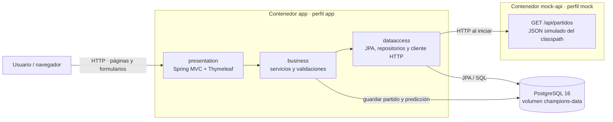

# Arquitectura y flujo de datos

La aplicación tiene tres capas. `presentation` contiene controladores MVC,
formularios, páginas Thymeleaf y estilos; `business` coordina importaciones,
valida predicciones y aplica reglas; `dataaccess` contiene entidades JPA,
repositorios y el cliente HTTP. Los controladores no acceden directamente a
la base de datos.

## Diagrama

## Secuencia de importación al iniciar

1. Compose espera a que PostgreSQL pase su comprobación de salud y a que la
   API simulada responda.
2. Spring inicia con el perfil `app`; Hibernate crea las tablas que falten
   (`ddl-auto=update`, nunca `create` ni `create-drop` en producción).
3. `MatchImportRunner` coordina `MatchImportService`, que consulta
   `MATCHES_API_URL` por HTTP. El cliente impone límites de conexión/lectura y
   reintenta un número acotado de veces; la espera ocurre fuera de la
   transacción de persistencia.
4. `MatchService` valida toda la respuesta y, en una sola transacción, inserta
   o actualiza cada partido por `id_externo`. Las predicciones no se eliminan.
5. Si la consulta o validación falla, el runner registra el error y aborta el
   inicio de la aplicación.

## Datos simulados

El perfil `mock` expone el JSON incluido en
`src/main/resources/mock-api/partidos.json` mediante `GET /api/partidos`.
Contiene ejemplos académicos, no calendario oficial. Este perfil excluye la
autoconfiguración JDBC/JPA y no realiza importaciones.
